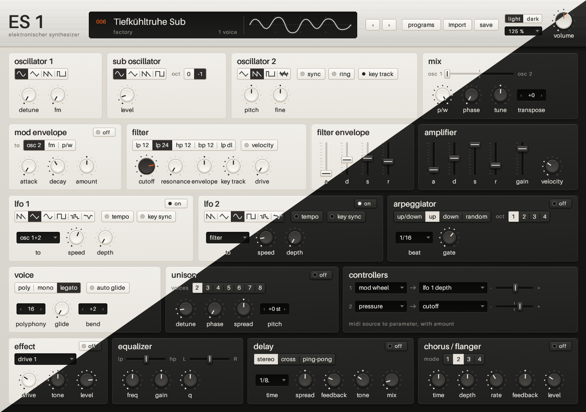

# ES 1 (Elektronischer Synthesizer)

ES 1 is a two-oscillator virtual analog synthesizer. The oscillators are band-limited and the
filters have zero-delay feedback.

<p align="center">
  
</p>

## Contents

1. [Introduction](#1-introduction)
2. [System requirements](#2-system-requirements)
3. [Installation](#3-installation)
4. [Quick start](#4-quick-start)
5. [The panel](#5-the-panel)
6. [How to operate the controls](#6-how-to-operate-the-controls)
7. [Signal flow](#7-signal-flow)
8. [Sound controls](#8-sound-controls)
9. [Programs and banks](#9-programs-and-banks)
10. [MIDI and host automation](#10-midi-and-host-automation)
11. [Troubleshooting](#11-troubleshooting)
12. [Factory programs](#12-factory-programs)
13. [Build from source](#13-build-from-source)
14. [Acknowledgements](#14-acknowledgements)
15. [License](#15-license)
16. [Trademarks](#16-trademarks)

## 1. Introduction

ES 1 is a software synthesizer in the VST3 plugin format. It operates in a host, for example a
digital audio workstation (DAW). ES 1 receives MIDI notes from the host and sends a stereo audio
signal to the host.

ES 1 has these functions:

* Two oscillators and a sub oscillator, with FM, ring modulation, hard sync and an 8-voice
  detune for oscillator 1
* A modulation envelope for the pitch of oscillator 2, the FM amount or the pulse width
* Five filter types: low-pass 12 dB/oct, low-pass 24 dB/oct, high-pass 12 dB/oct, band-pass
  12 dB/oct and a low-pass diode ladder, each with saturation
* Two LFOs, with tempo sync and key sync
* Poly, mono and legato modes, portamento, up to 32 voices and up to 8-voice unison
* An effect block (drive, wave folder, lo-fi, ring modulator, compressor, phaser), an equalizer,
  a tempo delay and a chorus/flanger
* An arpeggiator
* 64 factory programs, and import and export of `.sy1` patch files and `.zip` banks

## 2. System requirements

| System | Requirement |
|---|---|
| Windows | Windows 10 or 11, 64-bit (x86-64) |
| macOS | macOS 11 or later, Apple silicon or Intel |
| Linux | x86-64, glibc 2.35 or later (for example Ubuntu 22.04, Debian 12, Fedora 36 or later), X11 or XWayland, OpenGL |
| All | A VST3 host |

On Linux, the import and save dialogs use the file dialog of the desktop (xdg-desktop-portal).
GNOME, KDE and most other desktops have this dialog.

## 3. Installation

Get the installation file for your system from the Releases page of this repository.

The installation files do not have a code signature. Because of this, Windows and macOS can show
a warning the first time that you open them. The steps below tell you what to do.

### 3.1 Windows

Use the installer:

1. Open `ES1-<version>-windows-x64-setup.exe`.
2. If Windows SmartScreen shows a warning, click **More info**, then click **Run anyway**.
3. Read the license and click **Next**. You do not have to accept the license to use ES 1.
4. Keep the default folder, `C:\Program Files\Common Files\VST3`. All VST3 hosts look in this
   folder.
5. Click **Install**, then click **Finish**.
6. Start the host or scan the plugins again.

To install without the installer, extract `ES1-<version>-windows-x64.zip`. Copy the folder
`ES 1.vst3` into `C:\Program Files\Common Files\VST3`.

To remove ES 1, go to **Settings > Apps** and uninstall **ES 1**.

### 3.2 macOS

Use the installer package:

1. Open `ES1-<version>-macos-universal.pkg`.
2. If macOS blocks the package, open **System Settings > Privacy & Security**. Click **Open
   Anyway**.
3. Follow the instructions of the installer. ES 1 goes into `/Library/Audio/Plug-Ins/VST3`.
4. Start the host or scan the plugins again.

To install without the installer:

1. Extract `ES1-<version>-macos-universal.zip`.
2. Copy `ES 1.vst3` into `/Library/Audio/Plug-Ins/VST3` or into `~/Library/Audio/Plug-Ins/VST3`.
3. Remove the quarantine attribute. If you do not do this step, the host does not load ES 1.
   In Terminal, type:

   ```sh
   xattr -dr com.apple.quarantine "/Library/Audio/Plug-Ins/VST3/ES 1.vst3"
   ```

   If you used the `~/Library` folder, use that path.

To remove ES 1, delete `ES 1.vst3` from the plugin folder.

### 3.3 Linux

1. Extract `ES1-<version>-linux-x64.tar.gz`.
2. In the extracted folder, type `./install.sh`. This installs ES 1 into `~/.vst3` for your
   user only.
3. To install ES 1 for all users, type `sudo ./install.sh --system` instead. This installs ES 1
   into `/usr/lib/vst3`.
4. Start the host or scan the plugins again.

To remove ES 1, type `./install.sh --uninstall`. If you installed ES 1 for all users, type
`sudo ./install.sh --system --uninstall`.

## 4. Quick start

1. In the host, add ES 1 to an instrument track.
2. Open the ES 1 editor.
3. Play notes on your MIDI keyboard, or write notes in the host.
4. Click **›** to go to the next program. Click **‹** to go to the previous program.
5. Click **programs** to see all programs. Click a program name to load it.
6. Turn the **cutoff** knob in the **filter** section to change the brightness of the sound.

When you save the host project, the host also saves the ES 1 sound, the program name and the
banks that you imported.

## 5. The panel

### 5.1 Header

The header is the top line of the panel. From left to right, it has these items:

| Item | Function |
|---|---|
| **ES 1** wordmark | Click it to open the about panel (version, copyright and license). Click outside the panel or push Esc to close it. |
| Display, left side | The program number, the program name and the bank name. The display also shows messages, for example "saved". At the right, it shows the number of voices that play. |
| Display, right side | The scope. It shows the waveform of the output. On a held note, the scope locks to the pitch and the trace stays stable. |
| **‹** and **›** | Load the previous or the next program of the current bank. After the last program, ES 1 goes back to the first program. |
| **programs** | Shows the program browser instead of the sound controls. The key then shows **panel**. Click **panel** to go back. |
| **import** | Loads a `.sy1` patch or a `.zip` bank. Refer to [9.3](#93-import-patches-and-banks). |
| **save** | Saves the current sound as a `.sy1` file. Refer to [9.4](#94-save-a-sound). |
| **light** / **dark** | Sets the color scheme of the panel. ES 1 keeps this setting for all projects. |
| Size menu (below **light** / **dark**) | Sets the size of the editor window, from 50 % to 200 %. At 100 %, the window is 1136 × 798 pixels. On a small screen, select 75 % or less. ES 1 keeps this setting for all projects on the computer. |
| **volume** | The master volume, from silence to +9.2 dB. The center position is −1.7 dB. |

The program number shows `---` when the sound is not a program of the current bank, for
example a new sound.

### 5.2 Sections

Below the header, the panel has 18 sections in five rows. The sections follow the signal flow
from left to right and from top to bottom:

| Row | Sections |
|---|---|
| 1 | oscillator 1, sub oscillator, oscillator 2, mix |
| 2 | mod envelope, filter, filter envelope, amplifier |
| 3 | lfo 1, lfo 2, arpeggiator |
| 4 | voice, unison, controllers |
| 5 | effect, equalizer, delay, chorus / flanger |

Some sections have a lamp switch at the right of the section name. When the lamp is a solid
dot, the section is on. When the lamp is an empty ring, the section is off.

## 6. How to operate the controls

| Control | Operation |
|---|---|
| Knob | Drag up to increase the value. Drag down to decrease the value. |
| Fader | Drag the cap up or down. |
| Slider | Drag the cap to the left or to the right. |
| All knobs, faders and sliders | Hold Shift while you drag to make small changes. Double-click to set the default value. Turn the mouse wheel to change the value in steps. |
| Selector (a row of keys or wave symbols) | Click a key to select it. |
| Lamp switch | Click it to set the function on or off. |
| Menu cell (with **▾**) | Click it and select an item from the list. |
| Step cell (**‹ value ›**) | Click an arrow, drag left or right, or turn the mouse wheel. Double-click to set the default value. |

When you put the pointer on a knob, the knob shows its value with the unit. Hold the pointer on
a control to see the full parameter name.

Bipolar knobs (for example **pitch** or **amount**) have their zero point at the center. Their
scale lights from the center.

## 7. Signal flow

Each voice has this signal path:

```
oscillator 1 (with detune) ─┐
oscillator 2 ───────────────┼─ mix ─ filter ─ amplifier ─┐
sub oscillator ─────────────┘     (filter env)  (amp env)  │
                                                           │  sum of all voices
                                                           ▼
effect block ─ equalizer (peak EQ, tone, pan) ─ delay ─ chorus / flanger ─ volume ─ output
```

When the chorus is on, the output of the delay also goes through the chorus.

The two LFOs are global. All voices use the same LFO. The modulation envelope, the filter
envelope and the amplifier envelope operate separately in each voice.

## 8. Sound controls

The values in these tables are the ranges that the panel shows.

### 8.1 Oscillator 1

| Control | Range | Function |
|---|---|---|
| Wave | sine, triangle, saw, pulse | The waveform of oscillator 1. |
| **detune** | 0 to 20 ct | Plays oscillator 1 as 8 detuned copies, for a "supersaw" sound. At 0, there is one copy. |
| **fm** | 0 to 100 | Frequency modulation of oscillator 1 by oscillator 2. |

When ring modulation is on, **detune** and **fm** have no effect.

### 8.2 Sub oscillator

| Control | Range | Function |
|---|---|---|
| Wave | sine, triangle, saw, square | The waveform of the sub oscillator. |
| **oct** | 0, −1 | The sub oscillator plays at the pitch of oscillator 1 (0) or one octave lower (−1). |
| **level** | 0 to 100 | The level of the sub oscillator in the mix. |

### 8.3 Oscillator 2

| Control | Range | Function |
|---|---|---|
| Wave | triangle, saw, pulse, noise | The waveform of oscillator 2. |
| **sync** | on, off | Hard sync: oscillator 1 restarts the cycle of oscillator 2. |
| **ring** | on, off | Ring modulation: oscillator 2 modulates the amplitude of oscillator 1. |
| **key track** | on, off | When off, oscillator 2 does not follow the keyboard. It keeps a fixed pitch. |
| **pitch** | −60 to +60 st | The pitch of oscillator 2 in semitones. |
| **fine** | −62 to +61 ct | The fine pitch of oscillator 2 in cents. |

### 8.4 Mix

| Control | Range | Function |
|---|---|---|
| **osc 1 – osc 2** | slider | The balance between oscillator 1 and oscillator 2. With ring modulation on, it sets the amount of ring modulation. |
| **p/w** | 0 to 100 | The pulse width of the pulse waves. |
| **phase** | 0 to 100 | At 0, the oscillators run freely. Above 0, the oscillators restart at each note, with this phase difference between them. |
| **tune** | −62 to +61 ct | The fine tuning of the full synthesizer. |
| **transpose** | −24 to +24 | Transposes the keyboard in semitones. |

### 8.5 Mod envelope

The mod envelope is an attack-decay envelope. Set the lamp switch to on to use it.

| Control | Range | Function |
|---|---|---|
| **to** | osc 2, fm, p/w | The target: the pitch of oscillator 2, the FM amount or the pulse width. |
| **attack** | 0.5 ms to 28 s | The attack time. |
| **decay** | 10 ms to 60 s | The decay time. |
| **amount** | −100 to +100 % | The modulation amount. A negative value inverts the envelope. |

### 8.6 Filter

| Control | Range | Function |
|---|---|---|
| Type | lp 12, lp 24, hp 12, bp 12, lp dl | Low-pass 12 dB/oct, low-pass 24 dB/oct, high-pass 12 dB/oct, band-pass 12 dB/oct, low-pass diode ladder. |
| **velocity** | on, off | When on, the note velocity controls the amount of the filter envelope. |
| **cutoff** | 15 Hz to 16 kHz | The cutoff frequency. |
| **resonance** | 0 to 100 | The resonance. High values make the filter ring at the cutoff frequency. |
| **envelope** | −100 to +100 % | The amount of the filter envelope on the cutoff frequency. |
| **key track** | 0 to 100 | How much the cutoff frequency follows the note pitch. |
| **drive** | 0 to 100 | The saturation of the filter. |

**CAUTION:** High resonance with the **lp dl** filter can make a loud output. Decrease the
**volume** before you increase the resonance.

### 8.7 Filter envelope and amplifier

Each envelope has four faders:

| Fader | Range | Function |
|---|---|---|
| **a** | 0.5 ms to 28 s | Attack time |
| **d** | 10 ms to 60 s | Decay time |
| **s** | 0 to 100 (filter), silence to 0 dB (amplifier) | Sustain level |
| **r** | 10 ms to 60 s | Release time |

The amplifier section also has these controls:

| Control | Range | Function |
|---|---|---|
| **gain** | silence to 0 dB | The level of the voice. |
| **velocity** | 0 to −30 dB | The velocity sensitivity. At −30 dB, the softest notes are 30 dB quieter than the hardest notes. At 0, velocity has no effect on the level. |

### 8.8 LFO 1 and LFO 2

The two LFOs have the same controls. Set the lamp switch to on to use an LFO.

| Control | Range | Function |
|---|---|---|
| Wave | saw, triangle, sine, square, s&h, smooth | The LFO waveform. **s&h** is a random step. **smooth** is a smooth random curve. |
| **tempo** | on, off | When on, the LFO speed follows the host tempo. |
| **key sync** | on, off | When on, the LFO restarts at each new note. |
| **to** | osc 2, osc 1+2, filter, amp, p/w, fm, pan | The target: the pitch of oscillator 2, the pitch of both oscillators, the cutoff frequency, the level, the pulse width, the FM amount or the stereo position. |
| **speed** | 0.08 to 125 Hz | The LFO speed. With **tempo** on, the knob shows a note value from 1/96 to 16 bars. |
| **depth** | 0 to 100 | The modulation amount. |

### 8.9 Arpeggiator

The arpeggiator plays the held notes one after the other. Set the lamp switch to on to use it.

| Control | Range | Function |
|---|---|---|
| Mode | up/down, up, down, random | The order of the notes. |
| **oct** | 1 to 4 | The number of octaves that the arpeggiator plays. |
| **beat** | 1/1 to 1/96 | The length of each step as a note value, with dotted and triplet values. |
| **gate** | 0 to 100 | The length of each note as a part of the step. |

The arpeggiator uses the host tempo. It starts with the first note that you play. It does not
follow the song position of the host.

### 8.10 Voice

| Control | Range | Function |
|---|---|---|
| Mode | poly, mono, legato | **poly** plays chords. **mono** plays one note at a time. **legato** plays one note at a time, and the envelopes do not restart on connected notes. |
| **auto glide** | on, off | When on, the glide operates only on connected notes. |
| **polyphony** | 1 to 32 | The maximum number of voices. |
| **glide** | off to 2.5 s | The portamento time. |
| **bend** | 0 to 24 | The pitch bend range in semitones. |

### 8.11 Unison

Unison plays each note with more than one voice. Set the lamp switch to on to use it.

| Control | Range | Function |
|---|---|---|
| **voices** | 2 to 8 | The number of voices for each note. |
| **detune** | 0 to 100 ct | The pitch difference between the unison voices. |
| **phase** | 0 to 100 | The phase difference between the unison voices. |
| **spread** | 0 to 100 | The stereo width of the unison voices. At 50, all voices are at the center. Below 50, the left side and the right side change places. |
| **pitch** | −24 to +24 st | A pitch interval for every second unison voice, for example +12 for an octave. |

### 8.12 Controllers

The controllers section connects two MIDI sources to two parameters. Each line has these items:

| Item | Function |
|---|---|
| Source | The MIDI source: mod wheel, breath, cc 3, foot, porta time, data entry, volume, balance, cc 9, pan, expression (CC 1 to CC 11), pressure (channel pressure) or bend (pitch bend). |
| Target | The parameter that the source controls, or **none**. |
| **−** to **+** slider | The amount and the direction of the control. |

Most factory programs use the mod wheel for vibrato (LFO 1 depth) and channel pressure for the
cutoff frequency.

### 8.13 Effect

The effect block operates on the sum of all voices. Set the lamp switch to on to use it. The
labels of the three knobs change with the effect type:

| Type | Knob 1 | Knob 2 | Knob 3 |
|---|---|---|---|
| drive 1, drive 2 | drive | tone | level |
| fold (wave folder) | drive | tone | level |
| lo-fi (sample rate and bit reduction) | rate | bits | mix |
| ring (ring modulator) | freq | – (no function) | mix |
| comp (compressor) | thresh | time | gain |
| phase 1, phase 2, phase 4, phase 6 (phaser with 1, 2, 4 or 6 stages) | range | rate | feedback |

### 8.14 Equalizer

| Control | Range | Function |
|---|---|---|
| **lp – hp** slider | lp 200 Hz … flat … hp 8 kHz | The tone filter. To the left, a low-pass filter makes the sound darker. To the right, a high-pass filter makes the sound thinner. At the center, the filter has no effect. |
| **L – R** slider | L 100 … C … R 100 | The stereo position. |
| **freq** | 50 Hz to 16 kHz | The frequency of the peak EQ. |
| **gain** | −25 to +25 dB | The gain of the peak EQ. |
| **q** | Q 1 to Q 10 | The bandwidth of the peak EQ. A high Q gives a narrow band. |

### 8.15 Delay

Set the lamp switch to on to use the delay.

| Control | Range | Function |
|---|---|---|
| Mode | stereo, cross, ping-pong | **stereo**: two separate delay lines. **cross**: the feedback of each side goes to the other side. **ping-pong**: the echoes move from side to side. |
| **time** | 0, 1/96 to 1/1 | The delay time as a note value of the host tempo. |
| **spread** | −100 to +100 ms | A time difference between the left and the right side. |
| **feedback** | 0 to 100 | The amount of the echoes. |
| **tone** | lp … flat … hp | A low-pass or high-pass filter in the feedback path. |
| **mix** | 0 to 100 | The level of the echoes. |

**CAUTION:** High feedback values can make the echoes increase. Decrease the **feedback** if
the level increases.

### 8.16 Chorus / flanger

Set the lamp switch to on to use the chorus.

| Control | Range | Function |
|---|---|---|
| **mode** | 1, 2, 3, 4 | 1: mono. 2 and 3: stereo (these two modes are the same). 4: quad, with four delay taps. |
| **time** | 0.05 to 30 ms | The delay time. Short times give a flanger sound. Long times give a chorus sound. |
| **depth** | 0 to 100 | The modulation depth. |
| **rate** | 0.01 Hz to 400 Hz | The modulation speed. |
| **feedback** | −100 to +100 % | The feedback. High values give a stronger flanger sound. |
| **level** | 0 to 100 | The level of the signal that goes into the chorus line. This sets the strength of the effect. At 0, only the delay echoes go through the chorus line. |

## 9. Programs and banks

### 9.1 Banks

A bank is a list of programs. ES 1 always has the **factory** bank with 64 programs. Each bank
that you import becomes an additional bank.

### 9.2 Load a program

1. Click **programs**.
2. In the **banks** list, click a bank.
3. In the **programs** list, click a program.
4. Click **panel** to go back to the sound controls.

You can also click **‹** or **›** in the header.

When you load a program, the knob values move to the new values in approximately 0.2 s.
The notes that play stop.

### 9.3 Import patches and banks

ES 1 reads `.sy1` patch files and `.zip` files that contain `.sy1` files. These are the patch
files of Synth1 and of ES 1.

1. Click **import**.
2. Select a `.sy1` file or a `.zip` file. Click **Open**.

The result:

* A `.sy1` file becomes a new bank with one program. ES 1 loads this program immediately.
* A `.zip` file becomes one or more new banks. Each folder in the `.zip` file becomes one bank.
  The display shows the number of imported programs.

The host project keeps the imported banks. To remove an imported bank, click **×** next to the
bank in the **banks** list. You cannot remove the factory bank.

### 9.4 Save a sound

1. Click **save**.
2. Select a folder and a file name. The default file name is the program name.
3. Click **Save**. The display shows "saved".

The file is in the `.sy1` format. You can import it into ES 1 again, or load it into Synth1.

## 10. MIDI and host automation

### 10.1 MIDI messages

ES 1 receives MIDI on all channels.

| MIDI message | Function |
|---|---|
| Note on, note off | Plays notes. ES 1 uses the note velocity. |
| Pitch bend | Changes the pitch in the **bend** range (section 8.10). |
| CC 1 to CC 11 | Available as controller sources (section 8.12). |
| CC 64 (sustain pedal) | Holds the notes while the pedal is down. |
| CC 120, CC 123 | Stop all notes. |
| Channel pressure | Available as a controller source (section 8.12). |

### 10.2 Host automation

All sound controls and the master volume are host parameters. The host shows them in groups,
for example **Filter** or **LFO 1**. You can record and edit them with the automation of the
host.

## 11. Troubleshooting

| Problem | Possible cause | Action |
|---|---|---|
| The host does not show ES 1. | The host did not scan the plugin folder. | Make sure that `ES 1.vst3` is in the VST3 folder (section 3). Scan the plugins again in the host. |
| macOS: the host does not load ES 1. | The plugin has the quarantine attribute. | Remove the attribute (section 3.2, step 3). |
| The editor is larger than the screen. | The editor size is too large for the screen. | Select a smaller size in the size menu below **light** / **dark**, for example 75 %. |
| There is no sound. | The amplifier **gain** or the **volume** is at the minimum. | Increase these values. Load the factory program 001 to compare. |
| The sound is too loud or distorted. | The **drive**, the **resonance** or the delay **feedback** is too high. | Decrease these values, then decrease the **volume**. |
| The arpeggiator, the delay or a synced LFO has a wrong speed. | The host does not send a tempo. | Set the tempo in the host. Without a host tempo, ES 1 uses 120 BPM. |
| Linux: the import or save dialog does not open. | The desktop has no file dialog portal. | Install `xdg-desktop-portal` and a portal for your desktop, for example `xdg-desktop-portal-gtk`. |
| Windows: SmartScreen stops the installer. | The installer has no code signature. | Click **More info**, then click **Run anyway**. |

## 12. Factory programs

The factory programs have names of West German household electronics of the 1970s.

| No. | Program | No. | Program |
|---|---|---|---|
| | **Bass** | | **Keys** |
| 001 | Filterkaffee FK 1 | 031 | Elektroklavier E70 |
| 002 | Trockenrasur Bass | 032 | Fondueparty Piano |
| 003 | Rechenwerk Sub | 033 | Rechenschieber Clav |
| 004 | Entsafter Acid | 034 | Taschenrechner Bell |
| 005 | Toaster Krümel | 035 | Wohnzimmerorgel |
| 006 | Tiefkühltruhe Sub | 036 | Kirchentag Orgel |
| 007 | Sparschäler Pluck | 037 | Studio Vibraphon |
| 008 | Funktionsbass FM | 038 | Spieluhr Mechanik |
| 009 | Kompaktanlage Bass | | **Brass and strings** |
| 010 | Zentralheizung Bass | 039 | Tagesschau Fanfare |
| | **Lead** | 040 | Bundesbahn Bläser |
| 011 | Weniger aber Lead | 041 | Schlagerstreicher |
| 012 | Taschenradio T1 | 042 | Hitparade Synthbrass |
| 013 | Zündung Sync | 043 | Intercity Streicher |
| 014 | Föhnfrisur Lead | 044 | Fernsehballett |
| 015 | Rasierwasser Sinus | | **Pluck and sequence** |
| 016 | Gute Form Supersaw | 045 | Lochkarte Arp |
| 017 | Elektropfeife | 046 | Rechenzentrum |
| 018 | Diaprojektor Solo | 047 | Fernschreiber |
| 019 | Bildschirmtext Lead | 048 | Mondlandung Arp |
| 020 | Wählscheibe FM | 049 | Zitruspresse Pluck |
| | **Pad** | 050 | Kugelkopf Pluck |
| 021 | Schneewittchensarg | 051 | Stoppuhr Sequenz |
| 022 | Sonntagsfahrverbot | 052 | Datenträger Klick |
| 023 | Wohnlandschaft | 053 | Hollerith Arp |
| 024 | Orange Hängelampe | 054 | Kassettenrekorder |
| 025 | Teakholz Streicher | | **Effects** |
| 026 | Cordsofa Wärme | 055 | Staubsauger |
| 027 | Raumteiler Chor | 056 | Haartrockner Wind |
| 028 | Mondbasis Alpha | 057 | Kurzwelle Störung |
| 029 | Kristallvase | 058 | Weltempfänger |
| 030 | Ferienprospekt | 059 | Elektrorasierer |
| | | 060 | Kaffeemühle |
| | | 061 | Bildröhre Brummen |
| | | 062 | Wecker Rrring |
| | | 063 | Raumkapsel |
| | | 064 | Rohrpost |

## 13. Build from source

This section is for developers.

### 13.1 Requirements

* Rust. The file `rust-toolchain.toml` sets the Rust version. `rustup` installs this version
  automatically.
* Linux only: the X11, xcb and OpenGL development files. On Debian and Ubuntu, install
  `libx11-xcb-dev libxcb1-dev libxcb-icccm4-dev libxcursor-dev libgl-dev`.

### 13.2 Commands

```sh
cargo xtask bundle es1-vst3 --release        # build target/bundled/ES 1.vst3 (macOS: bundle-universal)
cargo test --workspace                       # run the tests
cargo run --release -p es1-render -- --all   # render all factory programs to target/render/*.wav
cargo run --release -p es1-render -- --bench # measure the CPU load of a worst-case sound
cargo run -p es1-plugin --features standalone --bin es1-standalone   # standalone, for work on the editor
```

To use the build, copy `target/bundled/ES 1.vst3` into the VST3 folder (section 3).

### 13.3 Crates

| Crate | Contents |
|---|---|
| `es1-dsp` | The sound engine: oscillators, filters, envelopes, LFOs, voices, effects, parameter table |
| `es1-presets` | The `.sy1` and `.zip` reader and writer, and the factory bank |
| `es1-plugin` | The nih-plug plugin, the egui editor and the standalone application |
| `es1-vst3` | The VST3 binary. It exports `es1-plugin`. |
| `es1-render` | The offline renderer and the benchmark |

### 13.4 Factory bank

The script `tools/factory_presets.py` makes the factory bank in `presets/factory/`. The script
writes each sound in musical units (Hz, seconds, semitones). It also has a level trim for each
sound. To change the bank, edit the script, type `python tools/factory_presets.py` and build
again.

### 13.5 Releases

The workflow `.github/workflows/release.yml` builds, tests and packages ES 1 for Windows, macOS
and Linux. Then it publishes a GitHub release. The workflow starts when you push a tag
`v<version>`. The tag must be the same as `version` in the workspace `Cargo.toml`.

1. Change `version` in the `[workspace.package]` section of `Cargo.toml`.
2. Commit the change.
3. Push the tag:

   ```sh
   git tag v0.4.2 && git push origin v0.4.2
   ```

If you start the workflow manually, it builds the packages but does not publish a release. The
packaging scripts are in `installer/`: NSIS for Windows, `pkgbuild` and `productbuild` for
macOS, and `install.sh` for Linux.

## 14. Acknowledgements

ES 1 is inspired by Synth1 by Daichi Laboratory, and also by the Clavia Nord Lead 2, which was
the model for Synth1. ES 1 is patch compatible with Synth1: ES 1 loads `.sy1` files and zip
banks, and Synth1 loads the sounds that ES 1 saves. ES 1 has no code from Synth1. The factory
programs of ES 1 are new sounds.

ES 1 uses these published DSP designs:

* The trapezoidal state-variable filter of Andrew Simper (Cytomic)
* The topology-preserving-transform ladder filter of Vadim Zavalishin (*The Art of VA Filter
  Design*)
* Polynomial BLEP and BLAMP band-limiting, after Välimäki et al.
* The biquad cookbook of Robert Bristow-Johnson
* The xorshift generator of George Marsaglia
* For the scope, the YIN pitch estimator of de Cheveigné and Kawahara

ES 1 is built on [nih-plug](https://github.com/robbert-vdh/nih-plug) (Robbert van der Helm),
[egui](https://github.com/emilk/egui) (Emil Ernerfeldt),
[baseview](https://github.com/RustAudio/baseview) and the
[vst3-sys](https://github.com/RustAudio/vst3-sys) bindings to the Steinberg VST 3 API. All
text in the editor is set in [Aileron](https://dotcolon.net/font/aileron/) by Sora Sagano.

## 15. License

Copyright (C) 2026 Claude Henchoz

ES 1 is free software: you can redistribute it and/or modify it under the terms of the GNU
General Public License as published by the Free Software Foundation, either version 3 of the
License, or (at your option) any later version.

ES 1 is distributed in the hope that it will be useful, but WITHOUT ANY WARRANTY; without even
the implied warranty of MERCHANTABILITY or FITNESS FOR A PARTICULAR PURPOSE. See the GNU General
Public License for more details.

You should have received a copy of the GNU General Public License along with ES 1 (see
[LICENSE](LICENSE)). If not, see <https://www.gnu.org/licenses/>.

The license applies to all of the repository, including the factory programs in
`presets/factory/`. The only exception is `vendor/`. It contains a modified copy of
egui-baseview with its own MIT license (refer to [vendor/README.md](vendor/README.md)). Each
source file of ES 1 has the header `SPDX-License-Identifier: GPL-3.0-or-later`.

The libraries that ES 1 uses have their own licenses. All of these licenses are compatible with
the GPL. Refer to [THIRD_PARTY_LICENSES.md](THIRD_PARTY_LICENSES.md). The script
`python tools/third_party_licenses.py` makes this file. Run the script after you change the
dependencies. `cargo xtask bundle` copies `LICENSE` and `THIRD_PARTY_LICENSES.md` into
`ES 1.vst3/Contents/Resources/`.

If you distribute a build of ES 1, the GPL also tells you to make the complete corresponding
source code available.

The editor uses the Aileron typeface by Sora Sagano, in the Regular and SemiBold weights. The
font files are in `crates/es1-plugin/assets/fonts/` and are part of the plugin. Aileron is in
the public domain (CC0 1.0 Universal, refer to `assets/fonts/LICENSE-CC0.txt`).

## 16. Trademarks

ES 1 is an independent project. Braun GmbH, Daichi Laboratory, Clavia DMI AB and Steinberg Media
Technologies GmbH do not approve or support ES 1, and ES 1 has no connection with these companies. Braun is
a trademark of Braun GmbH. Nord Lead is a trademark of Clavia DMI AB. VST is a trademark of
Steinberg Media Technologies GmbH. This manual uses these names only to identify the design
inspiration and the compatibility.
